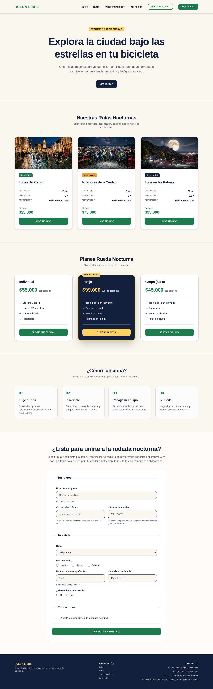
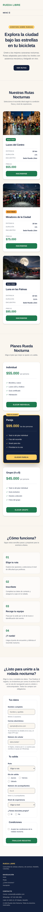
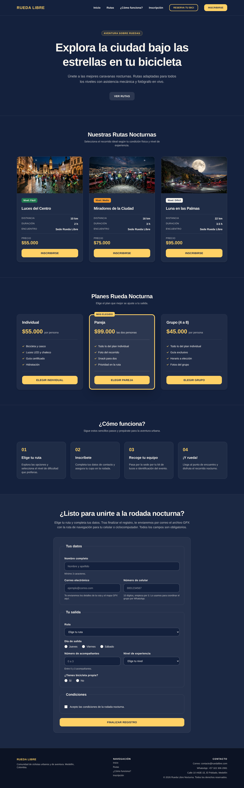

# Rueda Libre

Rueda Libre es un negocio de alquiler de bicicletas y rodadas guiadas en Medellín, Colombia. Este repositorio reúne dos productos que se publican juntos y se enlazan entre sí:

- **Sitio v2.0:** la página principal con quiénes somos, servicios, flota, rutas, tarifas y reservas.
- **Landing Rueda Nocturna:** la campaña de rodadas nocturnas, con rutas, planes, pasos para participar y formulario de inscripción.

## Enlaces publicados

- Sitio Rueda Libre v2.0: <https://fmtkazumy.github.io/rueda-libre/>
- Landing Rueda Nocturna: <https://fmtkazumy.github.io/rueda-libre/nocturna/>
- Repositorio: <https://github.com/FMTKazumy/rueda-libre>

Los dos productos están enlazados entre sí: el menú del sitio tiene el enlace **Rueda Nocturna**, y en la landing el logo lleva al inicio del sitio y el botón **Reserva tu bici** lleva a la página de reservas.

## Páginas

| Página | Ruta | Qué contiene |
| --- | --- | --- |
| Inicio | `index.html` | Portada, servicios, flota, rutas, beneficios y cómo alquilar |
| Tarifas | `paginas/tarifas.html` | Tablas de precios e información complementaria |
| Reservas | `paginas/reservas.html` | Formulario de reserva con validación nativa de HTML5 |
| Landing Rueda Nocturna | `nocturna/index.html` | Rutas nocturnas, planes, cómo funciona e inscripción |
| Kit de componentes | `nocturna/componentes.html` | Alertas del sistema y campos de formulario |
| Variantes de botones | `nocturna/botones.html` | Pruebas de los botones con Tailwind |
| Prototipo | `nocturna/prototipo.html` | Primer prototipo con Tailwind Play CDN |
| Prueba con Bootstrap | `pruebas/catalogo-bootstrap.html` | Primera comparación de la flota con Bootstrap |

## Tecnologías

- HTML5 semántico (`header`, `nav`, `main`, `section`, `article`, `footer`) y formularios con validación nativa.
- CSS propio (`css/styles.css`) con variables, Grid y Flexbox para el sitio.
- Bootstrap 5.3.8 por CDN para la grilla, las utilidades y los componentes del sitio v2.0.
- Tailwind CSS 4 con su CLI para la landing: colores y fuentes de marca en `@theme`, modo oscuro con la variante `dark:` y tres clases reutilizables con `@apply` (`.btn-primario`, `.etiqueta` y `.campo`).
- Google Fonts: Montserrat y Open Sans.
- Git y GitHub Pages para el control de versiones y la publicación.

## Recomendación de framework

Recomiendo **Tailwind** para la próxima versión de todo el sitio. Rueda Libre tiene identidad propia (paleta, tipografías y modo oscuro) y con Tailwind esa identidad vive en un solo lugar, `@theme`, en vez de en reglas que sobrescriben a Bootstrap. Para evitar el HTML largo se repiten con `@apply` solo las piezas pequeñas y repetidas (botón, etiqueta y campo).

Bootstrap fue útil para tarifas y reservas, donde importaba la rapidez: tablas, grilla y formularios estándar. Su costo fue que su Reboot chocó con la identidad de la marca y hubo que corregir esos choques en DevTools.

## Capturas

Escritorio (1280 px):

Celular (360 px):

Modo oscuro:

## Aprendizajes

- **Herencia:** `color` y `font-family` pasan de padre a hijo; `margin`, `padding` y el fondo no.
- **Box model:** con `border-box` el relleno y el borde no suman al ancho, así que las cards no se desbordan.
- **Flexbox y Grid:** Flexbox para acomodar en una sola dimensión y Grid cuando el contenedor define columnas y filas. En los planes, Grid da las tres columnas y cada card es una columna flex con el botón siempre al final.
- **Mobile-first:** los estilos base son los del celular y los puntos de quiebre agregan columnas. En el camino aparecieron tablas que se salían a 360 px, un `div` sin cerrar y un archivo con ñ en el nombre que podía dar 404 en GitHub Pages.
- **Bootstrap:** el orden de carga de las hojas decide quién gana la cascada, y sus utilidades llevan `!important`.
- **Tailwind:** `@theme` convierte la marca en utilidades propias y `@apply` reduce las clases repetidas (el HTML de la landing pasó de 899 a 743 clases).
- **Contraste:** Verde Ruta sobre Azul Noche daba 3.01:1 y no cumple el mínimo de 4.5:1; en modo oscuro se usa Amarillo Farol para textos y enlaces.
- **Destacar sin mover:** en los planes, la card Pareja lleva borde grueso de color y las demás tienen el mismo borde transparente, así el destaque no cambia el ancho ni el relleno de ninguna.

## Autor

[FMTKazumy](https://github.com/FMTKazumy)
